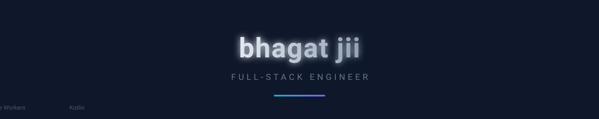

 

  

**Full-stack engineer** · Building **MeowBox** (file hosting) & **hawkin** (AI search).  
TypeScript, Next.js, Cloudflare Workers, Kotlin.

---

## 🛠 Featured Projects

### [MeowBox](https://github.com/BhagattJii/meowbox) — Free file hosting with direct links

Free, ad-free file hosting with **hotlinkable direct links** (up to 25 MB). Built on **Cloudflare Workers** with D1 + R2/KV storage. Every upload is malware-scanned before storage. Includes a public REST API for automation.

| Feature | Detail |
|---------|--------|
| Max file size | 25 MB |
| Storage | Cloudflare R2 / KV |
| API | REST (`/user/api.php`) |
| Malware scan | Every upload |

**Stack:** TypeScript · Cloudflare Workers · D1 · R2 · KV · Wrangler

---

### [hawkin](https://github.com/BhagattJii/hawkin) — AI-powered search engine

Privacy-first AI search engine inspired by Morphic. Self-hosted **SearXNG** for web-wide fetching, **OpenRouter free models** for AI answers with cited sources. Zero logs, zero tracking, zero cookies. Deployable on Render (SearXNG) + Vercel (UI).

| Component | Tech |
|-----------|------|
| Search backend | SearXNG (self-hosted on Render) |
| AI answers | OpenRouter free models |
| Frontend | Next.js + TypeScript (Vercel) |
| Database | Drizzle ORM |

**Stack:** TypeScript · Next.js · SearXNG · OpenRouter · Drizzle · Vercel · Render

---

## 🛠 Tech Stack

| Category | Technologies |
|----------|--------------|
| **Frontend** | TypeScript · Next.js (App Router) · React · Tailwind CSS |
| **Backend / Infra** | Cloudflare Workers · D1 · R2 · KV · Wrangler · SearXNG · Render · Vercel |
| **Mobile / Android** | Kotlin · Jetpack Compose · Gradle |
| **AI / Search** | OpenRouter · SearXNG · Drizzle ORM |
| **Tooling** | Git · GitHub Actions · Wrangler · Docker · pnpm · bun |

---

## 📫 Contact

| Platform | Link |
|----------|------|
| GitHub | [@BhagattJii](https://github.com/BhagattJii) |
| Instagram | [@i.lakshyy](https://www.instagram.com/i.lakshyy/) |
| Email | [meowboxteam@gmail.com](mailto:meowboxteam@gmail.com) |
| MeowBox | [meowbox.dpdns.org](https://meowbox.dpdns.org) |

---

  Built with care by <a href="https://github.com/BhagattJii">bhagat jii</a>

